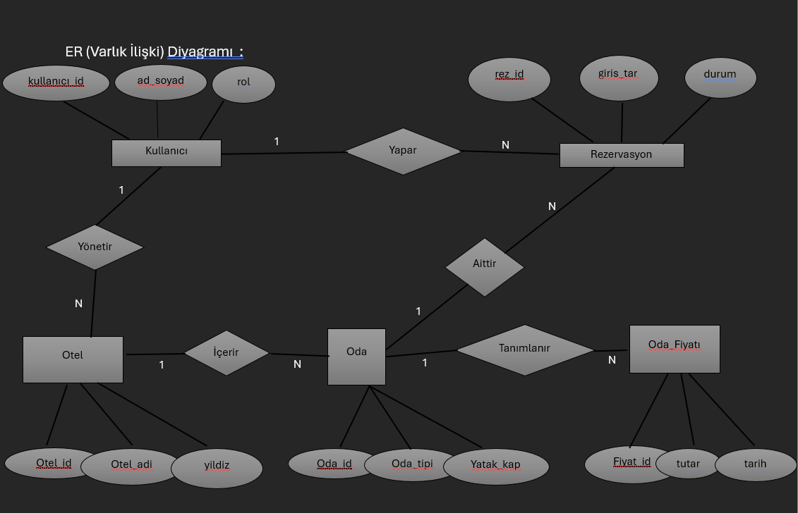

# hotel-reservation-sales-database
# Hotel / Pension / Holiday Resort Reservation and Sales System

A relational database project developed for the **Database Management Systems** course at Harran University. The project focuses on designing a database to manage accommodation facilities, room information, date-based pricing, customer reservations, and reservation-related sales data.

## 1. Project Description and Purpose

The purpose of this project is to design a Database Management System (DBMS) that brings together accommodation businesses, such as hotels, pensions, and holiday resorts, and customers looking for accommodation.

The system is designed to help accommodation businesses manage facility and room information while allowing customers to find suitable accommodation options and make reservations based on their preferences.

## 2. System and Requirements Analysis

### User Roles

The system defines three main user roles:

- **Customer:** Registers in the system, searches for accommodation, selects a suitable room, and makes a reservation for specific dates.
- **Hotel Manager:** Registers an accommodation facility, manages its information, defines room types, and maintains room pricing.
- **System Administrator (Admin):** Oversees the system and manages accommodation categories.

### Functional Requirements

- **User Registration:** Customers and accommodation managers can register in the system.
- **Facility Management:** Hotel managers can enter facility names, addresses, star ratings, facility types, and general facility information.
- **Room and Feature Management:** The system stores room types, views, bed capacities, and room sizes.
- **Date-Based Pricing and Availability:** Room prices can vary by date range, and room occupancy must be tracked for reservation dates.
- **Search and Listing:** Customers can search for accommodation by city, check-in and check-out dates, and guest capacity.
- **Reservation Management:** Customers can make reservations for selected date ranges when a room is available. The reservation process is designed to update the room's availability status.

### Assumptions and Constraints

- A room cannot be rented to multiple customers for the same overlapping date range.
- Reservations cannot be made for past dates.

## 3. Database Schema

The database design is represented by an Entity-Relationship (ER) diagram, which illustrates the main entities and their relationships.

### Main Entities and Relationships

The logical database model consists of five main tables:

| Table | Description |
|---|---|
| `Kullanicilar` | Stores user information, contact details, credentials, and roles. |
| `Oteller` | Stores accommodation details, including facility name, type, city, address, and star rating. |
| `Odalar` | Stores room information, including room type, bed capacity, size, and view. |
| `Oda_Fiyatlari` | Stores room prices and their associated date ranges. |
| `Rezervasyonlar` | Stores customer reservations, room references, check-in and check-out dates, total amounts, and reservation statuses. |

### Relationships

- A user can manage accommodation facilities or make reservations, depending on their role.
- An accommodation facility contains rooms.
- Rooms can have associated pricing records for different date ranges.
- Reservations connect customers with rooms and record the details of each booking.

Primary keys and foreign keys are used to define entity relationships and maintain referential integrity.

## 4. SQL Implementation

The database is created using Microsoft SQL Server and T-SQL.

The SQL script includes:

- Database creation using `CREATE DATABASE` and `USE`
- Table definitions using `CREATE TABLE`
- Primary key and foreign key constraints
- Identity columns and data integrity constraints
- Sample data insertion using `INSERT INTO`
- Queries for retrieving reservation details and summarizing accommodation and sales data

### Sample Data

The project includes example records for users, accommodation facilities, rooms, room prices, and reservations. These records demonstrate how the tables relate to one another and provide data for testing the SQL queries.

## 5. SQL Queries and Analysis

The project includes five example queries:

1. **Reservation Details:** Uses `INNER JOIN` to retrieve customer names, accommodation names, facility types, room names, and check-in/check-out dates.
2. **Accommodation Count by City:** Uses `COUNT()` and `GROUP BY` to calculate the number of accommodation facilities in each city.
3. **Above-Average Reservations:** Uses a subquery and `AVG()` to retrieve reservations whose total amount exceeds the average reservation amount.
4. **Upcoming Reservations:** Uses `JOIN` operations and date filtering to retrieve reservations with future check-in dates.
5. **Total Revenue by Accommodation:** Uses `SUM()`, `GROUP BY`, and `ORDER BY` to calculate and rank total reservation amounts by accommodation facility.

These queries demonstrate relational data retrieval, filtering, aggregation, and reporting with SQL.

## 6. Technologies and Concepts

- **Microsoft SQL Server**
- **T-SQL**
- Relational Database Management Systems (RDBMS)
- Entity-Relationship (ER) Modeling
- Logical Database Design
- Primary Keys and Foreign Keys
- SQL Joins
- Aggregate Functions
- Subqueries
- Data Integrity Constraints

## 7. How to Run

1. Open Microsoft SQL Server Management Studio (SSMS).
2. Connect to a SQL Server instance.
3. Open the SQL script file.
4. Execute the database creation and table definition statements.
5. Execute the sample data insertion statements.
6. Run the example queries to retrieve and analyze the data.

Execute the sections in the order in which they are defined in the SQL script.

## 8. Project Scope

This project focuses on the analysis and relational database design of an accommodation reservation and sales system. It includes system requirements, an ER diagram, a logical data model, SQL table definitions, sample data, and example queries.

The project was prepared as an academic assignment for the Database Management Systems course at Harran University.

## Author

**Emine Doğan**  
Data Science and Analytics Student  
Harran University
